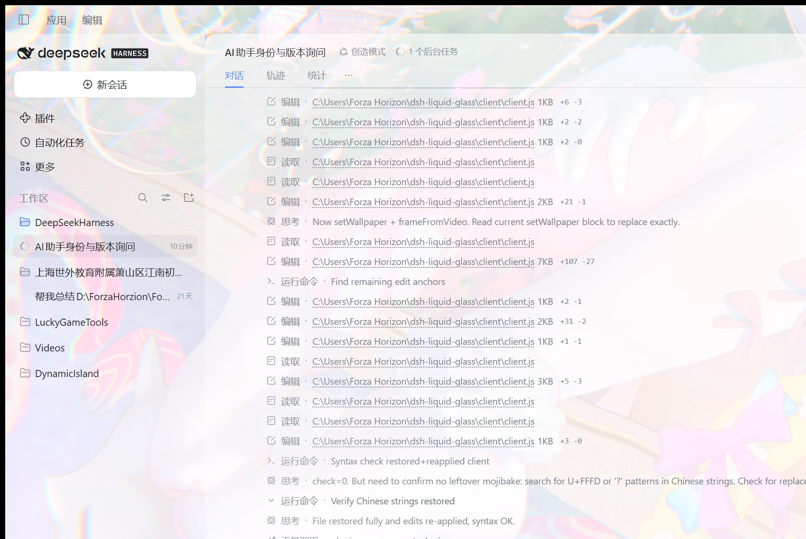

# Liquid Glass · 液态玻璃

把 **DeepSeek Harness 的背景换成你桌面壁纸本身**，并把面板变成会流动的半透明玻璃 —— 文字与面板悬空在液态玻璃上，玻璃后面就是桌面上真实的那张壁纸。



## 核心思路：映射真实壁纸，而不是在窗口里重画一张

Web / Electron 做不到真正的「透视窗口」（只有 macOS 的 DWM 级 API 才能），所以这里的做法是：**把桌面壁纸的原始像素按屏幕坐标映射到窗口内**。着色器用 `uWin` / `uScreen` / `uScale` / `uDpr` 把每个片元换算成「桌面上的哪个像素」，再做折射、色散与流动，因此窗口里的画面与窗口外桌面上的壁纸严格对齐 —— 换窗口位置、改变窗口大小、动态分辨率降级都不会让画面错位。

## 壁纸来源优先级（host 半）

1. **Wallpaper Engine 视频壁纸（最佳）**：读 `wallpaper64.exe` 的 `config.json`（UTF-8，不按 ANSI 读），取 `general.wallpaperconfig.selectedwallpapers.Monitor0.file` 指向的 mp4/webm，在 `/liquid-glass/wallpaper` 用 HTTP Range 提供。客户端用隐藏 `<video>` seek 到约 18% 处取一帧（2048 长边，`createImageBitmap` 后上传纹理），既拿得到壁纸原始画面，又**完全不含桌面图标**，也不用每秒截图。
2. **Wallpaper Engine 场景/网页壁纸**：没有可读的静态帧，退回桌面抓取（`PrintWindow(Progman, PW_RENDERFULLCONTENT)` + JPEG 90，缓存 `%TEMP%\dsh-liquid-glass\wallpaper.jpg`，12 秒过期）。
3. **普通静态壁纸**：`SystemParametersInfo(SPI_GETDESKWALLPAPER)` / `HKCU\Control Panel\Desktop` / `TranscodedWallpaper` 给出的图片文件，直接读文件，同样**不含桌面图标**。
4. **兜底**：Progman 截图（只有这一步的图里会带桌面图标）。

macOS / Linux 仍走 `System Events` / `gsettings` 的静态路径。

## 背景来源：真实桌面 / 壁纸本体

设置页的「背景来源」决定 `source` 查询参数，host 与 client 都按它取图：

- **真实桌面（含图标，默认）**：`source=desktop`。优先截图整个桌面（`PrintWindow(Progman)`，含桌面图标），映射到窗口里与外面的桌面 1:1 对齐 —— 看起来就是真·透视，图标也是「真」的。
- **壁纸本体（无图标）**：`source=wallpaper`。跳过一切截图，只用壁纸文件 / WE 视频帧，因此画面里永远不会有桌面图标。

两种模式共用同一套屏幕空间映射：`uWin`（窗口左上角在屏幕上的位置）+ `uScreen`（屏幕尺寸）+ `uScale` / `uDpr`，每个片元换算成「桌面上的哪个物理像素」，所以图标大小与桌面完全一致，不放大、不缩小、不镜像。纹理上传时 `UNPACK_FLIP_Y_WEBGL = false`，并在采样前做一次 `uv.y = 1 - uv.y`（GL 的 `gl_FragCoord` 从下往上、纹理行从上往下），镜像就是这么修掉的。

## 窗口后面有应用：合成「被遮住的那一层」，而不是暂停

`/liquid-glass/gate`（保留做诊断）每次由 `%TEMP%\dsh-liquid-glass\gate.ps1` 枚举 z-order 得到：先按标题 `*DeepSeek Harness*` 定位 DSH 主窗口，再扫描它**下方**的可见窗口，跳过 `Progman / WorkerW / Shell_TrayWnd / ApplicationFrameWindow / IME …` 等外壳类，也跳过**同进程**（`pid` 相同）与**同标题**的自家窗口，要求与 DSH 窗口的重叠面积 ≥ 40000 px²。

真正的显示路径不再看门控的结论，而是 `composite.ps1`：它以「屏幕尺寸」建画布，先用 `PrintWindow(Progman)` 画桌面底图（含图标），再按 z-order **从最底层往上**把所有位于 DSH 下方、可见、与 DSH 窗口有重叠、且不是外壳/自家窗口的应用窗口用 `PrintWindow(PW_RENDERFULLCONTENT)` 逐层贴上去，最后整幅缩到长边 2048 存 JPEG。于是 `/liquid-glass/wallpaper` 给出的就是「DSH 遮住的真实画面」：窗口后面若是浏览器/编辑器，玻璃里透出的就是那个应用的实际像素；若只有壁纸，就是壁纸本身。

- 没有应用在下面时：合成图 = 桌面，`appsBehind: false`。
- 有应用在下面时：`appsBehind: true` 且 `apps` 列出类名/标题/位置，玻璃继续流动、继续渲染，**不会暂停**。
- 小窗口（< 80×50 或面积 < 8000 px²）、任务栏/输入法/边缘 UI 等外壳窗口不参与合成，避免 4 px 的 Edge 输入条把界面判成「有应用」。
- 窗口最小化 / 切到其它虚拟桌面时页面本来就是 `hidden`，由第一层熔断停帧；这不影响合成图。

## 成本与性能取舍

- 合成只在 `mode === 'desktop'` 且缓存超过 12 秒时执行一次；`mode === 'wallpaper'` 完全不走截图。
- 合成耗时取决于下层应用数量：只有壁纸时约 1.5 s；每多一个全屏窗口约 +0.3–0.8 s（`PrintWindow` 渲染）。这条路径不再每 2 秒轮询 PowerShell —— 旧的 2 秒门控轮询占单核约 15%，现在客户端只在取壁纸时请求 `/state`，由 host 统一缓存。

## 液态玻璃层（client 半）

全屏 WebGL canvas 垫在 `<body>` 下（`z-index: -2`），对壁纸做**域扭曲（fbm domain warp）+ 指针涟漪 + 色散（chromatic dispersion）+ 焦散与高光**；`#root` 再用 `backdrop-filter: blur() saturate()` 磨砂，并通过 `theme.overrideTokens()` 把 `--dsw-alias-bg-base / bg-layer-1 / bg-layer-2 / bg-overlay / sidebar-fill / border-l1 / border-l2` 调成半透明，让 DSH 自己的面板、侧边栏、弹窗都透出壁纸；窗口边缘还有内阴影与高光构成的「玻璃厚度」。设置页文案跟随 DSH 语言（`locale` 服务的 `getSnapshot().active` + `subscribe`）。

## 设置页

`设置 → 液态玻璃`：总开关、壁纸同步、**背景来源**（真实桌面 / 壁纸本体）、背景模糊、饱和度、玻璃着色、壁纸压暗、轮询间隔、液态流动强度、帧率上限、动态分辨率，以及实时指标（渲染模式 / 目标帧率 / 渲染分辨率 / 累计帧数）。设置保存在 `localStorage` 键 `dsh-liquid-glass.settings.v2`。

## 性能保护（核显保命）

1. **生命周期熔断**：窗口隐藏 / 被完全遮挡 / 失去焦点 → 立刻停 rAF；回来等 300 ms 防抖再恢复，避免 Alt+Tab 抖 GPU。
2. **帧率上限**：24 / 30 / 40 / 48 / 60 / 90 / 120 / 144 / 无限制，默认 30。
3. **动态分辨率**：连续 10 帧超预算 → 1.0 → 0.8 → 0.65 → 0.5 逐级降；流畅 300 帧后再升回。画面因屏幕空间映射而不会跳位。
4. **按需渲染**：「液态流动」为 0 且鼠标静止 1.5 秒 → 完全挂起；移动/滚动/拖动立即唤醒。
5. **逃生舱**：`webglcontextlost` → 冻结并切 CSS 静态磨砂 + 底部提示；10 分钟内第二次则自动关闭插件，可在设置页或提示条重试。纹理长边上限 2048。

## 与苹果「液态玻璃」的差距

iOS 26 的 Liquid Glass 是 RenderServer 的 GPU 着色器：SDF（`CASDFLayer` / `CASDFElementLayer`）驱动折射位移，`_UIMultiLayer` 做高光与阴影，形状之间还能 metaball 融合。本插件用 WebGL 片元着色器近似了**折射扭曲、色散与高光**，但没有 SDF 场，玻璃边缘不会像苹果那样把背后的形状「挤」出物理正确的变形；`backdrop-filter` 本身也不做位移。视觉上接近，性质上是着色器近似。

## 配置

`cordis.patch.yml` 里的 `config.wallpaperPath` 为空时自动跟随系统壁纸；填绝对路径（png / jpg / webp / gif / bmp / mp4）可固定一个来源。

```yaml
- insert:
    - id: liquid-glass
      name: 'dsh-liquid-glass'
      config:
        wallpaperPath: 'D:\Pictures\glass.jpg'
```

## 已知限制

- 视频壁纸只取**一帧**，不会播放；换壁纸后按轮询间隔（默认 30 秒）重新取帧。
- 只支持主显示器；副屏不拼接。
- 合成截图对「最小化」或 UWP / 受保护内容（DRM 视频、部分游戏）可能贴出黑块；这类窗口会以 `apps` 里出现但不含画面。
- 合成有 12 秒缓存：刚把窗口拖到 DSH 下面时，最多约 12 秒后玻璃里才出现它（`refreshSec` 越短刷新越勤）。
- 壁纸接口监听本机地址但**未做额外鉴权**：同一台机器上能访问该端口的人也能取到壁纸。介意请只在可信环境启用。
- 非 Wallpaper Engine 且桌面图标可见时，若走到截图兜底，图里会带图标（前三档来源不会）。
- WebGL 不可用（驱动 / 远程桌面）时退回 CSS 壁纸 + 磨砂玻璃，没有流动与色散。
- 面板内部若有硬编码的不透明色，仍会挡住背景；需要 DSH 把该处改成主题 token。
